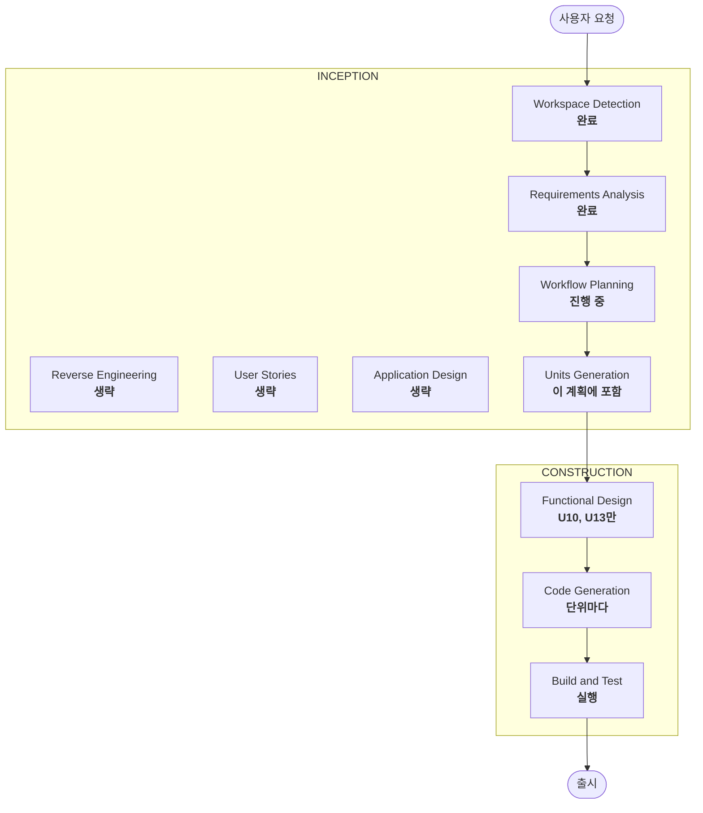

# 실행 계획 — 하꾸 iOS 앱스토어 출시

최종 갱신: 2026-10-28

## 분석 요약

### 변경 범위 (brownfield)
- **구조 변화**: 웹앱(PWA) → Capacitor로 감싼 iOS 앱. 화면 코드는 재사용하고, 웹 전용 기능(웹 푸시, 다운로드 링크, 서비스워커)을 앱 기능으로 바꾼다.
- **관련 구성요소**: `myhour/src`(화면·알림·저장·공유), `ai-server`(허용 주소, 이용권 확인), `media-server`(허용 주소), `push-server`(앱에서는 미사용, 웹 종료 시 정리), `.github/workflows`(iOS 빌드), 새 `myhour/ios`(Xcode 프로젝트)
- **변경 없는 것**: 기록 저장 구조(IndexedDB, localStorage 키), 영상 생성 엔진, AI 프롬프트

### 영향
- **사용자 화면**: 디자인 전면 교체, 페이월 추가, 권한 안내 추가
- **구조**: 네이티브 플러그인 계층 추가(알림, 파일, 공유, 결제)
- **데이터**: 기존 데이터 구조 유지. 이용권 상태는 RevenueCat이 관리
- **서버**: AI Worker가 요청마다 이용권을 확인. AI·Media Worker 허용 주소 추가
- **운영**: iOS 클라우드 빌드 파이프라인 신설, 웹 버전 종료

### 구성요소 관계

```text
[iOS 앱 (Capacitor)]
   |-- 화면 (React, 디자인 리뉴얼)
   |-- 네이티브 플러그인: 예약 알림 / 파일·공유·사진 저장 / RevenueCat
   |
   |--(텍스트·캡션 + 설치 토큰 + RevenueCat 사용자 ID)--> [hakku-ai Worker] --> OpenAI
   |                                                         |
   |                                                         +--(이용권 확인)--> RevenueCat API
   |
   +--(BGM 요청)--> [hakku-media Worker] --> R2
```

### 위험도: 높음
- 애플 심사 거절 위험 (최소 기능, 결제 안내, 개인정보)
- 결제·서버 이용권 확인이 틀리면 돈을 냈는데 못 쓰거나, 안 냈는데 AI 비용이 나감
- 클라우드 빌드·서명 설정은 처음이라 시행착오 가능
- 완화: 이용권 판정에 테스트, 샌드박스 결제 검증, TestFlight로 실제 기기 확인 후 제출

## 작업 흐름도



텍스트 대체: 작업 공간 확인(완료) → 요구사항 분석(완료) → 작업 계획(지금) → 작업 단위 확정(이 계획에 포함) → 단위별 기능 설계(U10, U13만) → 단위별 코드 생성 → 빌드·테스트 → 출시.

## 실행할 단계

### 🔵 INCEPTION
- [x] Workspace Detection — 완료
- [-] Reverse Engineering — 생략: 기존 맥락 문서로 충분
- [x] Requirements Analysis — 완료, 사용자 승인
- [-] User Stories — 생략: 사용자 유형이 하나이고 요구사항이 구체적임
- [ ] Workflow Planning — 이 문서
- [-] Application Design — 생략: 새 구성요소는 기존 경계 안의 통합(플러그인, Worker 확인 로직)이라 아래 단위 설명으로 충분
- [ ] Units Generation — 별도 단계 대신 이 계획의 "작업 단위" 목록으로 확정

### 🟢 CONSTRUCTION (단위마다)
- Functional Design — U10(알림 예약 규칙), U13(이용권 판정 규칙)만 실행
- NFR Requirements / NFR Design — 생략: 보안·비용 요구는 requirements.md 비기능 요구사항과 U13 기능 설계에 포함
- Infrastructure Design — 생략: 새 인프라는 U15 빌드 파이프라인뿐이고 코드 생성 계획에 포함
- Code Generation — 모든 단위 실행 (계획 → 구현)
- Build and Test — 모든 단위 완료 후 실행

### 🟡 OPERATIONS
- 자리만 있음. 앱스토어 제출은 U16에서 다룬다.

## 작업 단위와 순서

계정 없이 할 수 있는 단위를 먼저 한다. 디자인을 맨 앞에 둬서, 펌킨이 앱을 써보는 며칠 동안 새 디자인을 실제 폰(PWA)에서 확인할 수 있게 한다.

| 순서 | 단위 | 내용 | 계정 필요 |
|---|---|---|---|
| 1 | **U12 디자인 리뉴얼** | 캔버스 시안을 실제 화면에 반영 (홈, 오늘, 기록하기, 하루 마감, 아카이브, 설정, 탭바), 공통 색·글꼴 정리 | 없음 |
| 2 | **U8 iOS 앱 틀** | Capacitor 설치, `ios/` 프로젝트 생성, 앱용 빌드 설정(경로·서비스워커 제외), 권한 문구, 앱 이름·번들 ID | 없음 |
| 3 | **U10 예약 알림** | 폰 예약 알림으로 교체, 예약 계산 로직과 테스트 | 없음 |
| 4 | **U11 저장·공유** | 영상 사진 앱 저장, 공유 시트, 백업 내보내기·가져오기 앱 대응 | 없음 |
| 5 | **U9 서버 허용 주소** | AI·Media Worker에 `capacitor://localhost` 추가 (배포는 펌킨이 버튼 클릭) | 없음 |
| 6 | **U14 출시용 정리** | 테스트 도구 제거, 개발자 문구 정리 | 없음 |
| 7 | **U13 결제·페이월** | 페이월 화면, 이용권 판정, 구매 복원, AI Worker 이용권 확인 (키 없이 만들고 연결은 나중) | 연결 단계만 필요 |
| 8 | **U15 클라우드 빌드** | GitHub Actions macOS 빌드 → TestFlight 워크플로 (비밀값 등록은 나중) | 실행 단계만 필요 |
| 9 | **U16 앱스토어 제출** | 상품 등록, 스크린샷, 설명, 개인정보 항목, 웹 버전 종료, 심사 제출 | 필요 |

## 승인 방식 제안

저장소 규칙은 단위마다 "코드 생성 계획 승인 → 구현 → 완료 승인"을 요구한다. 진행 속도를 위해:
- **U12, U8, U10, U11, U9, U14**는 각 단위의 코드 생성 계획을 문서로 남기되, 이 실행 계획 승인으로 계획 승인을 갈음하고 단위가 끝날 때마다 결과를 보고해 완료 승인을 받는다.
- **U13, U15, U16**은 돈·서명·심사가 걸려 있으므로 계획 승인을 따로 받는다.

## 성공 기준
- TestFlight로 펌킨 아이폰에서 기록 → 알림 → 하루 마감 → AI 연출 → 영상 저장까지 동작
- 결제 안 한 상태에서 영상 만들기·AI 연출이 막히고, 서버도 거절함
- 샌드박스 결제 후 즉시 열리고, 구매 복원이 동작함
- `pnpm check` 통과, 새 로직 테스트 포함
- 애플 심사 통과
